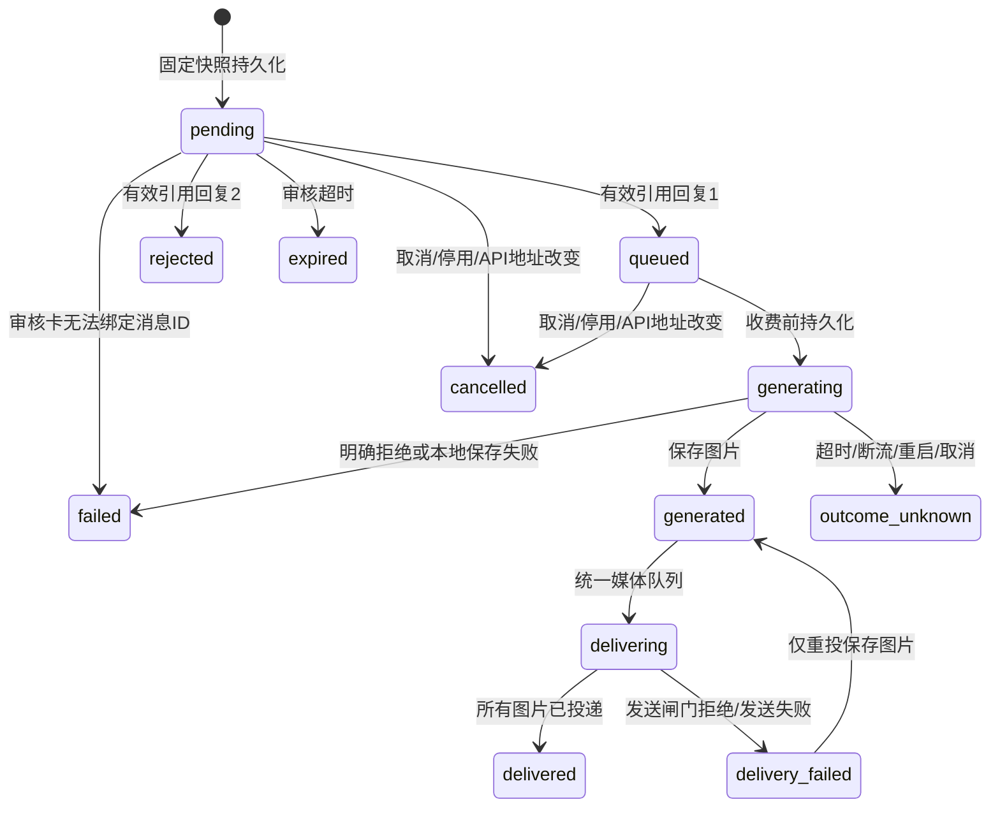

# 独立文生图插件

插件ID为 `image-generation`，随包分发，默认不启用。它只实现 OpenAI 兼容 `POST /images/generations` 文生图，与聊天模型的 API、Key 和读图能力探测无关；聊天模型页不探测、不推断也不展示生图能力。插件只依赖Node内置模块，无DSH运行依赖，不实现改图或厂商私有异步协议。

## 一次任务

1. AI调用 `plugin_image_generate({prompt,count?})`。宿主提供来源会话与请求者身份，参数中不接受目标会话或管理员身份。
2. 任务与固定参数快照先原子落盘，立即返回 `{ok:true,taskId,status:"pending"}`。工具不等待QQ审核或生成。模型与尺寸由管理员固定，张数不超过配置上限。
3. 后台向显式配置的每个审核管理员私聊发送请求，持久化每条审核消息ID、接收人和会话。卡片列出来源、请求者、完整prompt、模型、尺寸、张数与有效期。
4. 管理员必须在本人私聊中**引用该卡片**回复 `1` 同意或 `2` 拒绝。验证当前管理员身份、私聊会话、引用归属、有效期与pending状态。第一条有效决定原子生效，其他管理员和重复回复不会再次排队。不支持无引用数字、任务ID口令、全角数字或说明性文字作为批准。
5. 同意先持久化queued，再由worker持久化generating，之后才请求一次收费接口。没有生成后的第二次看图审批。
6. 图片写入宿主分配的 `plugin-data/image-generation/images/`，通过 `ctx.deliverMedia` 进入与AI回复共用的会话串行器、白名单、出站审计及限流闸门，投递原会话。每张已发送结果分别持久化，后续只重投尚未成功的图片。



## 配置与授权

在插件页配置以下字段，API Key使用password凭据字段，经宿主保险箱保存；不会写入任务快照、普通工具结果或日志。

| 字段 | 默认值 | 含义 |
| --- | --- | --- |
| `apiUrl` | 空，必填 | 独立生图API基址或完整generations端点。可显式用本机HTTP服务；拒绝URL内凭据、查询和片段 |
| `apiKey` | 空，必填 | 独立生图Key，只通过Bearer头发送给配置端点 |
| `model` | 空，必填 | 固定生图模型，与聊天模型无关 |
| `admins` | 空，必填 | 逗号/空白分隔的审核管理员QQ；建议一位，多人先到决定有效 |
| `size` | `1024x1024` | 固定尺寸，也接受 `auto` |
| `count` | 1 | 默认张数，同时为每任务上限，1–8 |
| `timeoutMs` | 180000 | 生成POST、回包读取、URL下载的总超时 |
| `approvalTtlMs` | 600000 | 审核有效期 |
| `concurrency` | 1 | 后台生成/投递总并发，最大4 |
| `maxPending` / `maxPerRequester` | 20 / 3 | 全局与每请求者未完成任务上限 |
| `requestsPerHour` / `imagesPerDay` | 10 / 30 | 滑动1小时提交次数、24小时提交张数；拒绝和取消也计数，跨重启保留 |
| `maxImageBytes` | 10485760 | 单张最大10MiB，与统一媒体投递一致 |
| `maxStorageBytes` | 524288000 | 已存图片、孤儿文件及待生成最大容量的总限额 |
| `retentionDays` / `maxTasks` | 7 / 1000 | 终态保留时间及任务库上限；结果不明记录不自动删除 |
| `deliveryAttempts` / `deliveryRetryMs` | 3 / 30000 | 自动投递尝试次数与间隔；绝不自动重试生图 |

启用需显式允许插件高风险工具（`plugins.allowDangerous: true`）。生成工具声明 **R2 + paid + net + data.write + chat.send + chat.send.media**，`approval: "plugin"` 由宿主清单验证为trusted/in-process收费插件后生效：它把通用工具确认交给插件的具体前置审批，不降低风险，不是无副作用工具。

群聊或普通私聊还必须在相应 `plugins.chatTools.group/private` 授权档打开 `enabled`，点名完整工具名 `plugin_image_generate`，并设置 `allowPaid: true`。收费例外不接受 `*`，禁止主动回合，exec和QQ账号写入仍然禁止。查询、取消、重投工具也需在该档点名：

```json
{
  "plugins": {
    "allowDangerous": true,
    "enabled": ["image-generation"],
    "chatTools": {
      "group": {
        "enabled": true,
        "tools": ["plugin_image_generate", "plugin_image_task", "plugin_image_cancel", "plugin_image_retry_delivery"],
        "allowPaid": true
      }
    }
  }
}
```

这是局部配置示意，合并到现有配置，保留其他已启用插件。审核管理员私聊及目标会话也必须获宿主QQ发送白名单放行；插件不会绕过白名单自动加人。

## 与聊天模型能力的关系

- 聊天模型设置页不探测、不展示、不推断生图能力：那里的「探测模型」只测读图（视觉）与通道，探测结果里没有生图项，也不会因为聊天模型名像图像模型（如 `dall-e` / `flux` / `sd` / `imagen`）就认定它能生图。
- 生图模型、API 地址和 Key **只在本插件页配置**，与聊天模型的地址、Key、模型互不复用；更换聊天模型不会改动本插件配置，反之亦然。
- 插件页的「测试连接」只做本地配置校验：检查地址格式、Key、模型、审核管理员是否齐全，以及尺寸与限额等字段是否合法。它**不请求任何网络接口**，不验证上游连通性，也**绝不生成图片**或产生费用。上游是否真的可用，只能在通过管理员引用审批后的真实任务中验证；插件不会为了"测试"去调用收费接口。
- 测试通过的提示只表示本地配置可用，不代表上游鉴权、额度或模型权限已经确认。

## 查询、取消与恢复

- `plugin_image_task({taskId})`：仅原会话原请求者可查。配置的审核管理员在本人私聊可管理任务。返回明确状态、错误码、是否已生成、每张投递结果及媒体句柄，不返回base64、图片URL或磁盘绝对路径。原会话查询会重新注册已保存文件句柄，避免句柄过期；管理员在其他会话查询不会获得跨会话新句柄。
- `plugin_image_cancel({taskId})`：pending/queued取消不计费；generating取消保守记为outcome_unknown，停止后续投递，无法承诺服务商停止计费。已经发出的图片无法通过此工具撤回。
- `plugin_image_retry_delivery({taskId})`：只接受已生成但投递失败的任务，读取保存文件，不再次调用生成API。已成功发送的图片跳过。自动投递次数用尽仍可显式重新发起投递。
- 正常停用：取消pending/queued，打断generating并记outcome_unknown；已生成图片保留，需重新启用后显式重投。
- 异常重启：pending沿用未过期卡片消息ID；还未开始通知的pending补发卡片。queued恢复，generating绝不重放，generated继续投递。delivering转delivery_failed并要求人工重投，因为QQ可能已经收到而本地尚未提交发送结果。
- API地址改变：旧pending/queued取消，需重新提交审批，防止新Key被用于旧端点。模型/尺寸/张数使用已审批固定快照。Key不落盘，恢复时使用当前配置Key；若Key失效明确失败，不自动重新生成。
- 收费请求发送后发生网络超时、断流、5xx、坏JSON、无图或下载失败时，保守记outcome_unknown。明确HTTP 4xx记failed，也不自动重试。用户必须向服务商核实后决定是否提交新任务。

任务库通过临时文件、文件sync和原子rename提交，并在内存发布新状态前完成磁盘提交；存储失败立即暂停后续任务。worker锁阻止同一数据目录双实例运行。死PID遗留的主锁可在互斥回收锁保护下回收；若进程恰在锁回收窗口崩溃，遗留回收锁会保守阻止启动，需要确认无活跃worker后人工处理。PID被其他进程复用、锁文件损坏也会保守拒绝，不猜测恢复。

## 媒体、安全与清理

协议兼容 `data[].b64_json`、`data[].url` 和嵌套 `image_url.url`。base64严格校验，图片以PNG/JPEG/GIF/WebP魔数识别；JSON响应预算随张数增长，硬限64MiB。上游图片URL视为不可信：HTTP(S)、DNS所有结果检查、公网IP固定连接、保留Host/SNI、拒绝重定向，下载不携带API Key。显式配置的本机生图端点与上游返回的私网图片URL分开处理，后者禁止下载。

清理在启动时与每小时运行：到期已完成、拒绝、失败、取消、投递失败任务及图片移除；至少一天未引用的孤儿图片删除；outcome_unknown元数据保留供核实，触及任务上限时停止接单。临时任务提交文件只由插件生成，不作为恢复输入。运行数据放在宿主dataDir，不进入插件代码包。

## 本地验证

```powershell
node --test --test-isolation=none test/image-generation-protocol.test.mjs test/image-generation.test.mjs test/image-generation-recovery.test.mjs test/image-generation-host.test.mjs
```

测试使用本机HTTP模拟图片API、模拟QQ发送与真实宿主媒体队列/闸门适配。覆盖身份/私聊/引用/有效期/重复审批、多管理员竞争、并发上限、固定快照与调用去重、拒绝、限额、取消、超时、重启、停用、单实例锁、投递失败不重新生成、已投递图片跳过、SSRF与解码限额。无需真实凭据，不启动机器人，不发送QQ，不请求真实生图接口。`--test-isolation=none`避免沙箱中node:test隔离子进程的命名管道限制。

限制：QQ投递没有端到端幂等事务，QQ成功而本地记录前崩溃时无法保证绝对不重复发送；因此中断投递要求人工确认后显式重试。管理员审核卡发出而消息ID尚未落盘时崩溃，旧卡不能批准，任务等待过期后重新提交。文件sync+rename不承诺断电下硬盘控制器缓存的绝对耐久；本轮未执行真实收费或真实QQ联调，也未新增专用图像管理UI。
